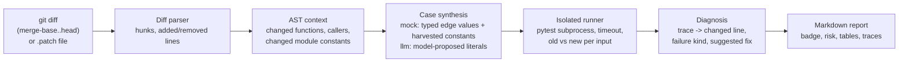
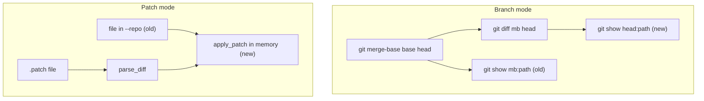
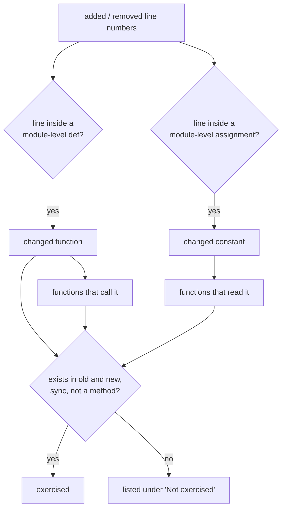

# Architecture

## Pipeline

## Where the old and new source come from

Patch application checks every context and removed line against the file on disk. If they don't match, the scan stops with an error instead of guessing.

## What gets tested

## The differential check

For each generated input, the harness calls the old function, then the new one. Both are built from the same argument expressions, but each call gets fresh objects, so if one version mutates its input the other doesn't see it.

| Old | New | Result |
|---|---|---|
| returns `a` | returns `b`, `a` equals `b` | pass |
| returns `a` | returns `b`, different | behaviour change (review) |
| returns `a` | raises | crash regression (fail) |
| raises | raises (any type) | pass: both reject the input |
| raises | returns | now accepts rejected input (review) |

Crashes re-raise inside the new module, so pytest's traceback ends on the real line in the changed file. The old result is attached as an exception note, which is why Python 3.11+ is required.

## Isolation

- The generated suite lives in a fresh temp directory and has its own empty `pytest.ini`, so the target repo's config and conftest files don't apply.
- `PYTEST_DISABLE_PLUGIN_AUTOLOAD=1` and `-p no:cacheprovider` keep runs reproducible and quick to start.
- A wall-clock timeout kills the subprocess, which catches infinite loops in the changed code.
- LLM-proposed inputs go through an `ast` allow-list (literals and `Decimal('...')` only) before they are written into the suite.

## Risk score

`lines_changed / 20 + changed_functions + sum(branch_nodes) / 5`. Below 3 is Low, below 8 is Medium, and anything higher is High. The score reflects only how much the diff touches, not the test results, so a reviewer can see it before reading anything else.
