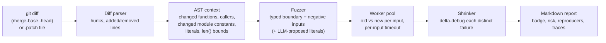
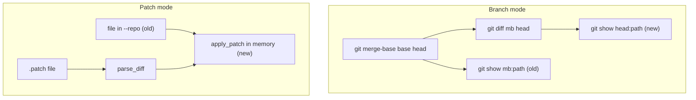
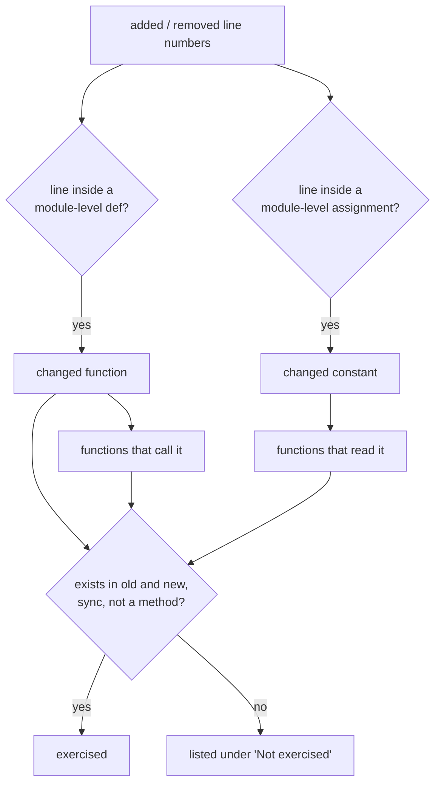

# Architecture

## Pipeline



## Where the old and new source come from



Patch application checks every context and removed line against the file on disk. If they don't match, the scan stops with an error instead of guessing.

## What gets tested



## Worker protocol and timeouts

```mermaid
sequenceDiagram
    participant P as Parent (runner.py)
    participant W as Worker (worker.py)
    P->>W: spawn, with old/new module paths
    W-->>P: ready (modules imported; import errors kept as results)
    loop each input
        P->>W: {file, func, args, kwargs} as JSON line
        Note over P: wait up to the timeout
        W-->>P: phase=new (old call finished)
        Note over P: wait up to the timeout again
        W-->>P: result: pass / value_change / crash / now_accepts
    end
    Note over P,W: on timeout or EOF: kill W, record the result, spawn a fresh worker
```

- Each reply line starts with a marker, so anything the code under test prints is ignored. The code under test gets an empty stdin, and its stdout is redirected to stderr.
- A timeout or crash during the **old** call means the old code fails on that input too, so it isn't counted against the PR.
- After 3 timeouts in the new version of a function, its remaining inputs are skipped and the report says so.
- The worker is stdlib-only and runs as a plain script. The project itself has no runtime dependencies.

## Shrinking

For each distinct failure signature `(file, function, outcome, exception type, line)`, the shrinker evaluates the failing input into Python values. It then tries strictly smaller candidates for each argument in turn:

| Value | Candidates |
|---|---|
| list / tuple | empty, first half, second half, each element removed (16 items or fewer), each element shrunk |
| str | empty, halves, each character removed (8 or fewer) |
| dict | empty, each key removed, each value shrunk |
| int / float / Decimal | 0, 1, integer part, half, one step towards zero |

A candidate is kept only if it reproduces the same signature, so shrinking can't drift onto a different bug. "Smaller" is measured by a size function, which guarantees termination, and each failure gets at most 200 attempts. Values are turned back into source with `to_src`, which also handles `nan` and `inf`, so the reproducer can be pasted straight into a test.

## Risk score

`lines_changed / 20 + changed_functions + sum(branch_nodes) / 5`. Below 3 is Low, below 8 is Medium, and anything higher is High. The score reflects only how much the diff touches, not the test results, so a reviewer can see it before reading anything else.
